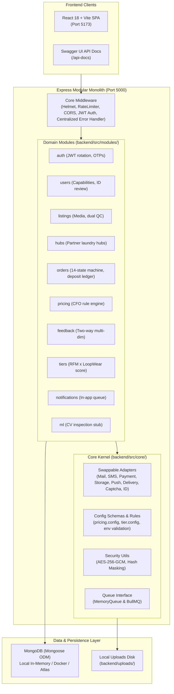
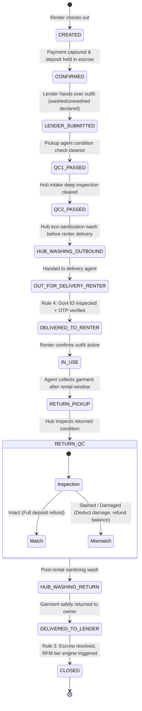
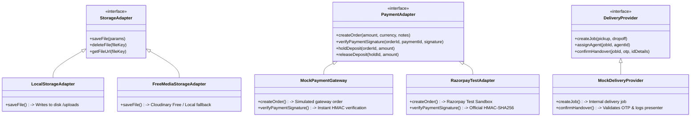
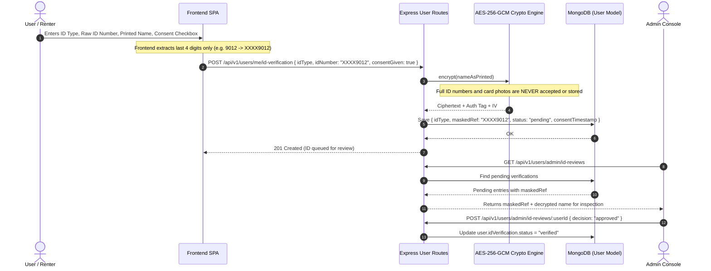

# LoopWear (Closet Circle) – Backend Architecture Presentation

**Prepared for:** Engineering Lead / Technical Steering  
**System Type:** Node.js + Express Modular Monolith  
**Database:** MongoDB + Mongoose  
**Design Patterns:** Domain-Driven Modular Monolith, Swappable Adapter Pattern, Finite State Machine, Event Sourcing (Audit Logs)  
**Status:** 100% Complete & Passing (6 Suites, 46 Automated Tests, Zero Compilation Warnings)

---

## 1. Executive Summary & Design Principles

LoopWear is a peer-to-peer luxury clothing rental platform operating in India. The backend orchestrates garment turnover, dual quality checks (QC1/QC2), sanitization, logistics, security deposit escrow, and automated RFM tier loyalty calculations.



### Core Architecture Mandates
1. **Zero-Budget Rule**: Zero paid SDKs, zero paid cloud services, and zero paid API keys. All external services sit behind swappable interfaces with working local stubs that gracefully activate when keys are omitted.
2. **Modular Monolith**: Code is grouped strictly into self-contained domain modules under `backend/src/modules/<module>/` with four standard layers:
   - `*.routes.js`: HTTP endpoint routing and input validation triggers.
   - `*.controller.js`: Thin HTTP orchestration; extracts params and returns standardized JSON.
   - `*.service.js`: Complete business logic isolation, transaction safety, and domain rules.
   - `*.model.js`: Mongoose schema, indexing, pre-save hooks, and invariant constraints.
3. **Core Isolation**: `backend/src/core/` houses cross-cutting utilities (config, db, crypto, adapters, queues, error handlers) with **zero domain business logic**.

---

## 2. Directory Topology & Layer Separation

```
backend/
├── src/
│   ├── app.js                          # Express application setup & middleware stack
│   ├── server.js                       # HTTP server lifecycle & graceful shutdown
│   ├── core/                           # Shared Kernel (zero business logic)
│   │   ├── adapters/                   # Zero-budget swappable adapter interfaces
│   │   │   ├── captcha.adapter.js      # Turnstile / Dev bypass
│   │   │   ├── delivery.adapter.js     # MockDeliveryProvider & handover checks
│   │   │   ├── idVerification.adapter.js # In-house admin queue & stub
│   │   │   ├── mail.adapter.js         # Nodemailer SMTP / Console stub
│   │   │   ├── payment.adapter.js      # MockPaymentGateway / Razorpay Test Mode
│   │   │   ├── push.adapter.js         # FCM free tier / In-app notification store
│   │   │   ├── sms.adapter.js          # Console stub (no paid SMS gateway)
│   │   │   └── storage.adapter.js      # Local disk / Cloudinary free tier
│   │   ├── config/                     # Strict Zod environment schema & business configs
│   │   │   ├── env.js                  # Runtime env validation
│   │   │   ├── pricing.config.js       # CFO pricing rules (zero hardcoding)
│   │   │   └── tier.config.js          # RFM tier thresholds & perks
│   │   ├── db/                         # MongoDB connection & automated seeder
│   │   ├── docs/                       # OpenAPI 3.0 Swagger configuration
│   │   ├── middleware/                 # authenticate, roleGuard, rateLimiter, errorHandler
│   │   ├── queue/                      # MemoryQueue (in-process) & BullMQ (Redis)
│   │   └── utils/                      # AES-256-GCM crypto, masking, standardized response
│   └── modules/                        # Domain Modules
│       ├── auth/                       # Signup, login, email/phone OTPs, JWT rotation
│       ├── feedback/                   # Two-way multi-dimension order rating
│       ├── hubs/                       # Local partner laundry hub management
│       ├── listings/                   # Wardrobe listings, media caps, dual QC verification
│       ├── ml/                         # Computer vision inspection stub (queue, worker, client)
│       ├── notifications/              # In-app notifications & read receipts
│       ├── orders/                     # 14-state lifecycle engine & deposit escrow ledger
│       ├── pricing/                    # Rule-driven dynamic price quotes
│       ├── tiers/                      # RFM + LoopWear composite score calculation
│       └── users/                      # Multi-capability sets, ID review queue, info endpoint
└── tests/                              # Jest + Supertest suites (46 tests across 6 suites)
```

---

## 3. The 14-State Item Lifecycle Engine (Core System Anchor)

LoopWear forbids direct lender-to-renter delivery and operates without a central warehouse. All turnover routes through partner local laundry hubs. The item lifecycle is enforced through a **formal state machine** with immutable, append-only event logging.



### State Machine Guarantees
- **Rejection of Invalid Transitions**: Out-of-sequence state changes throw HTTP `400 INVALID_STATE_TRANSITION`.
- **Immutable Audit Trail (`eventLogs`)**: Every transition appends an immutable document containing:
  ```typescript
  {
    fromState: string,
    toState: string,
    actorId: ObjectId,
    actorRole: 'renter' | 'lender' | 'hub_staff' | 'delivery_agent' | 'admin' | 'system',
    action: string,
    timestamp: Date,
    metadata?: object
  }
  ```
- **Rule 4 Handover Verification Barrier**: An order *cannot* transition to `DELIVERED_TO_RENTER` without:
  1. Verification of the 6-digit OTP sent to registered contacts.
  2. Physical check of the government ID (presented by renter or recorded representative).

---

## 4. The Zero-Budget Swappable Adapter Architecture

Under the **Adapter Rule**, all external services are decoupled behind common interfaces. When API keys are missing, the system falls back to zero-cost local stubs without throwing errors:



| Adapter | Zero-Budget Local Stub | Funded Production Upgrade | Auto-Fallback Trigger |
|---|---|---|---|
| **Payment** | `MockPaymentGateway` (in-memory simulator) | Razorpay Live / Stripe Escrow | Activates if `RAZORPAY_KEY_ID` is omitted |
| **Email OTP** | `ConsoleMailAdapter` (stdout terminal log) | Nodemailer Free SMTP / Brevo (300/day) | Activates if SMTP credentials are blank |
| **SMS OTP** | `ConsoleSmsAdapter` (stdout log) | Fast2SMS / Gupshup Transactional SMS | Permanent stub until funded (saves ₹0.40/OTP) |
| **Media Storage** | `LocalStorageAdapter` (`backend/uploads/`) | Cloudinary Free Tier / AWS S3 + CDN | Activates if Cloudinary keys are blank |
| **Push Alerts** | `InAppNotificationAdapter` (DB queue) | Firebase Cloud Messaging (FCM free tier) | Default fallback route for all accounts |
| **Bot Protection** | `DevBypassCaptchaAdapter` | Cloudflare Turnstile (1M free checks/mo) | Controlled by `DEV_BYPASS_CAPTCHA=true` |
| **Govt ID Check** | In-House Admin Manual Review Queue | Setu / Karza / HyperVerge DigiLocker OCR | Stub in place; manual review protects privacy |
| **Logistics** | `MockDeliveryProvider` (in-house agents) | Porter / Dunzo / Shadowfax B2B API | Stub in place; agents use mobile handover portal |

---

## 5. Security & Privacy Architecture (Government ID & DPDPA Compliance)

LoopWear handles government identity verification (Aadhaar, Voter ID, Ration Card) strictly complying with the **Information Technology Act, 2000** and **Digital Personal Data Protection Act (DPDPA), 2023**:



### Sensitive Data Storage Matrix
- **Raw 12-digit Aadhaar / Voter IDs**: ❌ **NEVER stored, NEVER accepted, NEVER logged.**
- **Identity Document Images/Photos**: ❌ **NEVER uploaded or accepted.**
- **Masked Reference**: Stored as `XXXX<last4>` (e.g., `XXXX9012`).
- **Printed Legal Name**: Encrypted at rest using **AES-256-GCM** with a 32-byte secret key and authentication tag.
- **Log Redaction**: Global middleware sanitizes `headers.authorization`, `password`, `otp`, `idNumber`, and tokens before outputting to stdout.

---

## 6. Business Engines: Dynamic Pricing & RFM Tier Model

### A. CFO Dynamic Pricing Engine ([`pricing.service.js`](file:///d:/Closet%20Circle/backend/src/modules/pricing/pricing.service.js))
Zero hardcoded rupee amounts. Pricing is rule-driven from [`pricing.config.js`](file:///d:/Closet%20Circle/backend/src/core/config/pricing.config.js):
$$\text{Total Renter Payable} = \text{Discounted Rent} + \text{Security Deposit} + \text{Laundry Fee} + \text{Delivery Fee} + \text{Discounted Platform Fee}$$

- **Multi-day Duration Discounts**: $\ge 7\text{ days} = 10\%\text{ off}$, $\ge 14\text{ days} = 20\%\text{ off}$.
- **Security Deposit**: Rule-based % of retail value, reduced dynamically based on the renter's tier ($0\%$ Silver up to $40\%$ Diamond discount).
- **Lender Payout**: $\text{Discounted Rent} \times (1 - \text{Commission}\%)$.

### B. RFM x LoopWear Score Loyalty Engine ([`tier.service.js`](file:///d:/Closet%20Circle/backend/src/modules/tiers/tier.service.js))
User loyalty tiers (`Silver`, `Gold`, `Platinum`, `Diamond`) are derived from four normalized dimensions:
$$\text{Composite Score} = R_{\text{norm}} \times F_{\text{norm}} \times M_{\text{norm}} \times \text{LoopWear Score}$$

1. **Recency ($R$)**: Days since last closed transaction ($1\text{ to }5$).
2. **Frequency ($F$)**: Count of completed rental/lending transactions ($1\text{ to }5$).
3. **Monetary ($M$)**: Total platform spend or payout earned ($1\text{ to }5$).
4. **LoopWear Score**: Blends qualitative executive score ($1.0 - 5.0$) with verified rolling peer feedback.
- **Zero-Out Prevention**: Normalized bands start at 1, preventing new users from zeroing out.
- **Dual Triggers**: Evaluated event-driven upon order closure, and nightly via an idempotent runner protected by `CRON_SECRET`.

---

## 7. Quality Assurance & Test Verification

The backend enforces strict testing gates via Jest and Supertest. All suites run against an isolated in-memory MongoDB instance with zero external dependencies.

```
Test Suites: 6 passed, 6 total
Tests:       46 passed, 46 total
Snapshots:   0 total
Time:        48.815 s
```

### Verified Test Suites
1. [`tests/unit/core.test.js`](file:///d:/Closet%20Circle/backend/tests/unit/core.test.js): AES-256-GCM crypto encryption/decryption, masking utilities, MemoryQueue lifecycle, adapter fallbacks.
2. [`tests/unit/db.test.js`](file:///d:/Closet%20Circle/backend/tests/unit/db.test.js): Mongoose connection hooks, schema constraints, and seeder idempotency.
3. [`tests/integration/auth_and_user.test.js`](file:///d:/Closet%20Circle/backend/tests/integration/auth_and_user.test.js): Email/phone OTP verification, JWT access/refresh rotation, capability switching (Rule 5), ID verification queue, and redaction verification.
4. [`tests/integration/pricing_and_listings.test.js`](file:///d:/Closet%20Circle/backend/tests/integration/pricing_and_listings.test.js): CFO rule-driven pricing calculations, listing CRUD, media constraint caps (6 photos + 25MB video), and dual QC listing activation.
5. [`tests/integration/order_lifecycle.test.js`](file:///d:/Closet%20Circle/backend/tests/integration/order_lifecycle.test.js): 14-state lifecycle machine transitions, invalid transition rejections, immutable audit logs, deposit ledger hold/deduct/release, and OTP-gated delivery handover.
6. [`tests/integration/feedback_and_tiers.test.js`](file:///d:/Closet%20Circle/backend/tests/integration/feedback_and_tiers.test.js): Two-way multi-dimension ratings, rolling feedback averages, composite RFM tier calculation, and nightly batch recomputation.

---

## 8. Summary of Technical Strengths for Your Lead

| Architecture Dimension | How It Is Solved in LoopWear | Lead Talking Point |
|---|---|---|
| **Separation of Concerns** | Strict 4-layer modular monolith (`routes`, `controller`, `service`, `model`) with zero domain logic in `core/`. | *"Business logic is completely isolated in services. Controllers are thin (<30 lines) and handlers validate all inputs via Zod."* |
| **Financial Escrow Safety** | Explicit deposit ledger tracking hold, deduct, and release with immutable event records. | *"Zero risk of lost deposits. Damage deductions during return QC are backed by full audit trails."* |
| **Zero-Budget & Portability** | Swappable adapter pattern for every vendor. Runs locally with zero keys; embedded Mongo fallback. | *"A new developer or tester can clone the repo and run tests or dev servers without any cloud accounts or API keys."* |
| **State Rigor** | 14-state lifecycle finite state machine. Transitions append timestamped audit events with actor ID & role. | *"Items cannot skip quality checks or sanitization washes. Handover is blocked at the database level without valid OTP and ID."* |
| **DPDPA Identity Compliance** | Full ID numbers and card images are rejected. Only masked references are kept; names are encrypted via AES-256-GCM. | *"Complies with Indian privacy laws. No liability for raw Aadhaar storage."* |
| **Dynamic Configuration** | CFO owns pricing; marketing owns tiers. Changes are made in config files without code refactoring. | *"Platform fees, duration discounts, and tier thresholds can be adjusted without code changes or database migrations."* |
