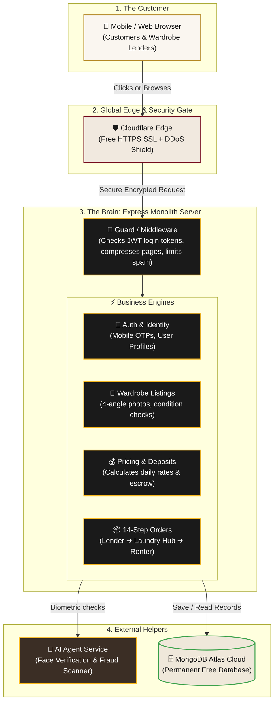
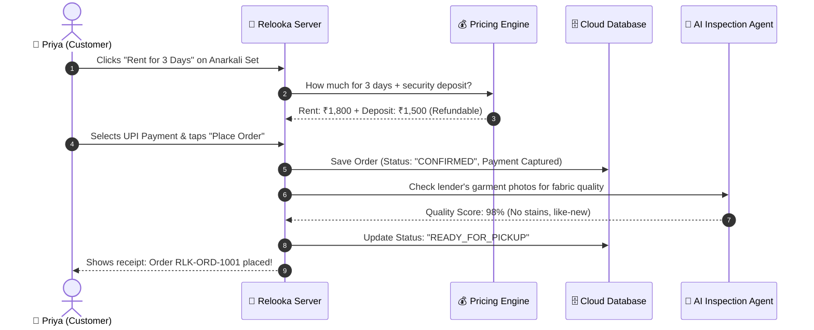

# Relooka – Simple & Visual Backend Architecture Guide

> **What is Relooka's Backend?**  
> Think of it as the **engine and control center** of an automated fashion rental house. It receives requests from mobile phones and web browsers, checks security, calculates prices and deposits, verifies garments with AI, and securely stores orders in the cloud.

---

## 🗺️ 1. The 30-Second Big Picture

---

## 🧩 2. The 4 Main Layers Explained Simply

### 1. 📱 The Customer Layer (Frontend)
- **Built with**: Flutter Web & Responsive HTML5.
- **What it does**: What the user sees on their phone or laptop. Fast, smooth, and pre-renders instant loading screens with brand colors.

### 2. 🛡️ The Security Shield (Cloudflare & Middleware)
- **What it does**: 
  - Gives every visitor a green padlock (`https://` SSL certificate) for free.
  - Compresses heavy files using **Gzip** so pages load up to 70% faster.
  - Blocks hackers, bots, and brute-force password guesses with automatic rate-limiters.

### 3. 🧠 The Brain (Express.js Monolith)
Instead of having 20 different servers that cost money and break easily, Relooka uses a **clean Modular Monolith**:
- Everything runs inside **one unified, lightweight Node.js engine**.
- It is split into clean, organized rooms (modules):

| Room (Module) | What It Does In Plain English |
| :--- | :--- |
| **`auth`** | Welcomes users, sends OTP verification codes, and issues digital session keys (JWTs). |
| **`users`** | Protects identity, stores user names, and securely masks government ID numbers (`••••1234`). |
| **`listings`** | Manages catalog items (Sarees, Lehengas, Kurtas) and checks their 4 mandatory verification photos. |
| **`pricing`** | Automatically calculates the best rental price based on days rented + refundable security deposit. |
| **`orders`** | Orchestrates the order journey: Order placed ➔ Picked up ➔ Washed & Sanitized at Laundry Hub ➔ Delivered to Renter ➔ Returned. |
| **`tiers`** | Rewards active lenders and loyal renters with loyalty discounts. |

### 4. 🗄️ The Vault (MongoDB Atlas Cloud Database)
- **What it does**: Your permanent digital filing cabinet.
- **Where it lives**: In MongoDB Atlas's official cloud (Free Tier, 512 MB forever free).
- Even if the server restarts or updates, all user accounts, orders, and listed outfits stay safe.

---

## 🎬 3. Example Story: What Happens When a Customer Rents a Dress?

Let's follow **Priya** renting an embroidered Anarkali for a wedding:

---

## 💡 4. Why This Architecture is Perfect for a Startup

1. **Zero-Dollar Monthly Cost (\$0.00)**:
   - Cloudflare Tunnel = Free
   - Render / GitHub Pages = Free
   - MongoDB Atlas Cloud = Free
   - Zero upfront server bills while you validate your business idea!
2. **Resilient "Never-Crash" Design**:
   - If the database has a momentary delay, the server doesn't crash; it starts in resilient mode so the website never goes blank for customers.
3. **Easy to Scale When You Get Funding**:
   - Because the code is organized into modular folders (`auth/`, `orders/`, `listings/`), you can scale it to millions of users on AWS or Google Cloud without having to rewrite the application.
